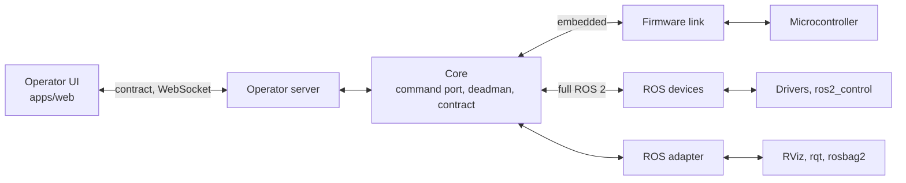
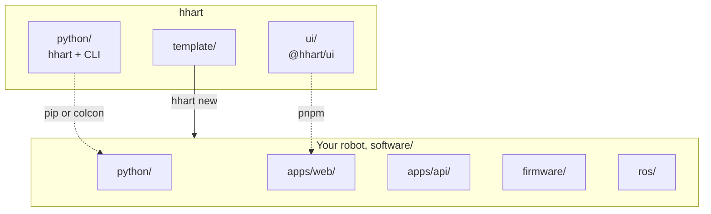

# HHART

Hybrid Hexagonal Architecture for Robotic Technologies. A way to structure a
robot's codebase so ROS stays on the robot and the logic can be tested without
it.

Accepted at the Australasian Conference on Robotics and Automation
([ACRA 2026](#citing)). v0.1.0. Licensed under [Apache-2.0](LICENSE).

**ROS support: Only ROS 2 Jazzy confirmed for now.** The core, UI and tests run without
ROS on any OS.

> [!NOTE]
> Some features of the HHART tool are currently unstable and may not work
> properly, as the tool wasn't part of the original plan. I'm working through
> a lot of bugs to push what will hopefully be a more stable release. In the
> meantime, the [template](template/) is the best guide to how a robot is laid
> out: the core, the adapters, the operator UI in
> [apps/web](template/software/apps/web/) and the tests that check the rules.

- Robot logic lives in a core with no ROS or I/O.
- ROS and hardware sit behind adapters.
- Operators use a browser UI over a WebSocket contract, no ROS.
- Tests check the structure and fail the build when a rule breaks.

## Architecture

One core, two ways to reach the hardware. Everything above the device adapters
is shared.



## Rules

| # | Rule |
| --- | --- |
| 1 | Operators never see ROS. |
| 2 | The core is the centre. |
| 3 | One command path. |
| 4 | Conventions in the core. |
| 5 | ROS by role. |
| 6 | Contracts at the boundary. |
| 7 | Device ownership. |
| 8 | Layered stop. |
| 9 | Checked in the build. |
| 10 | Unattended deployment. |

See [template/README.md](template/README.md#rules).

## Repo



| Read | For |
| --- | --- |
| [template/README.md](template/README.md) | Rules, evaluation, robot layout, running a robot |
| [python/README.md](python/README.md) | `hhart` modules, rule checks, contract API |
| [ui/README.md](ui/README.md) | UI components, 3D slots, styling |
| [template/software/apps/web/README.md](template/software/apps/web/README.md) | A robot's operator UI |
| [template/software/apps/api/README.md](template/software/apps/api/README.md) | Recordings API |
| [template/agentic-workflow/README.md](template/agentic-workflow/README.md) | Instructions for coding agents |
| [CONTRIBUTING.md](CONTRIBUTING.md) | Making changes, commits, releases |
| [SECURITY.md](SECURITY.md) | Reporting security issues |
| [CHANGELOG.md](CHANGELOG.md) | Changes per version |

## Start a robot

With pip:

```text
uv venv && source .venv/bin/activate     # Windows: .venv\Scripts\activate
uv pip install hhart
hhart new myrobot
```

With colcon:

```bash
cd ~/ws/src && git clone --branch v0.1.1 https://github.com/HHART-Robotics/HHART.git hhart
cd ~/ws && colcon build --packages-select hhart && source install/setup.bash
ros2 run hhart hhart new myrobot --into src
```

Then follow the new robot's README.

| Command | |
| --- | --- |
| `hhart new NAME [--into DIR] [--route embedded\|ros\|both]` | Copy the template as NAME |
| `hhart check [PATH]` | Run the rule checks, exit 1 on a fail |
| `hhart contract [PATH]` | Regenerate `CONTRACT.md` and the UI's golden fixture |

## Develop

```text
uv venv && source .venv/bin/activate     # Windows: .venv\Scripts\activate
uv pip install -e "python[dev]" -e "template/software/python[dev]"
pytest python/tests
pytest template/software/python/tests
hhart check template
pnpm install
pnpm typecheck && pnpm test
pnpm --filter robot1-web build
```

## Versions

One version for the whole repo, [semver](https://semver.org). Before 1.0.0,
minor releases can break things. Each tag also pushes `ui/` and `python/` to
read-only mirrors, [HHART-UI](https://github.com/HHART-Robotics/HHART-UI) and
[HHART-Python](https://github.com/HHART-Robotics/HHART-Python). Open issues and PRs
here, not on the mirrors.

## Citing

J. Russell and S. Kodagoda, "HHART: A Hybrid of Hexagonal Architecture and
ROS 2 for Industry-Linked University Robotics Research", in *Proceedings of the
Australasian Conference on Robotics and Automation (ACRA 2026)*, Canberra, 2026.

```bibtex
@inproceedings{russell2026hhart,
  author    = {Russell, Jackson and Kodagoda, Sarath},
  title     = {{HHART}: A Hybrid of Hexagonal Architecture and {ROS} 2 for Industry-Linked University Robotics Research},
  booktitle = {Proceedings of the Australasian Conference on Robotics and Automation (ACRA 2026)},
  address   = {Canberra, Australia},
  year      = {2026}
}
```

## Licence

Everything in this repo (`python/`, `ui/` and `template/`) is licensed under the
[Apache License 2.0](LICENSE) (Apache-2.0). See [NOTICE](NOTICE). The
HHART-Python and HHART-UI mirrors carry the same licence.

In a robot made with `hhart new`, the files that came from the template stay
Apache-2.0. The robot's own code can use any licence.
