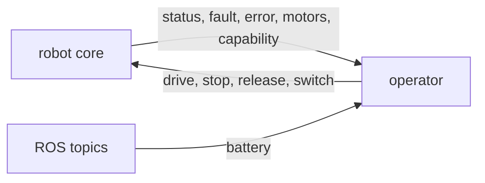

# Operator contract, version 0.1.0

Generated from the robot's contract registry; edit the registry, not this file.

Every message is a JSON object with a `type`. On connect the robot sends `describe`: the version and every message below. Unknown types are ignored.

## Curated (tier 1)

| Message | Direction | Fields |
| --- | --- | --- |
| `status` | robot to operator | `connected` bool, `route` str |
| `fault` | robot to operator | `device` str, `text` str, `active` bool |
| `error` | robot to operator | `text` str |
| `motors` | robot to operator | `left_pct` int, `right_pct` int |
| `capability` | robot to operator | `name` str, `running` bool, `error` str or null |
| `drive` | operator to robot | `direction` str, `pct` int |
| `stop` | operator to robot | none |
| `release` | operator to robot | none |
| `switch` | operator to robot | `name` str, `running` bool |

## Declared ROS topics (tier 2, robot to operator, read-only)

| Message | ROS topic | ROS type | Fields |
| --- | --- | --- | --- |
| `battery` | `/battery_state` | `sensor_msgs/msg/BatteryState` | `voltage_v` = `voltage` (V), `charge` = `percentage` (0 to 1) |
